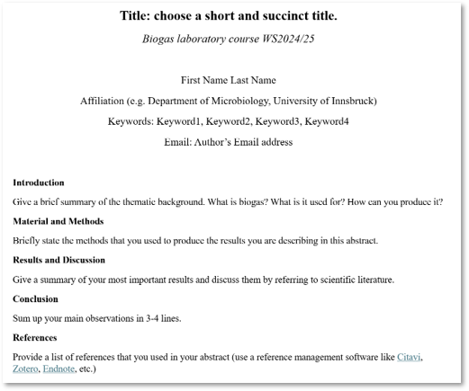
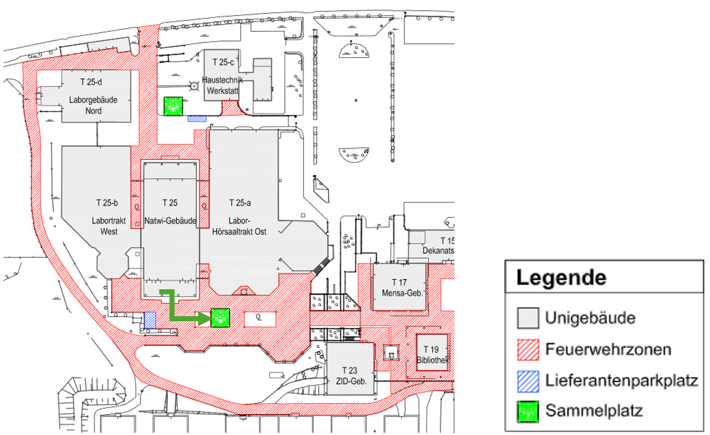
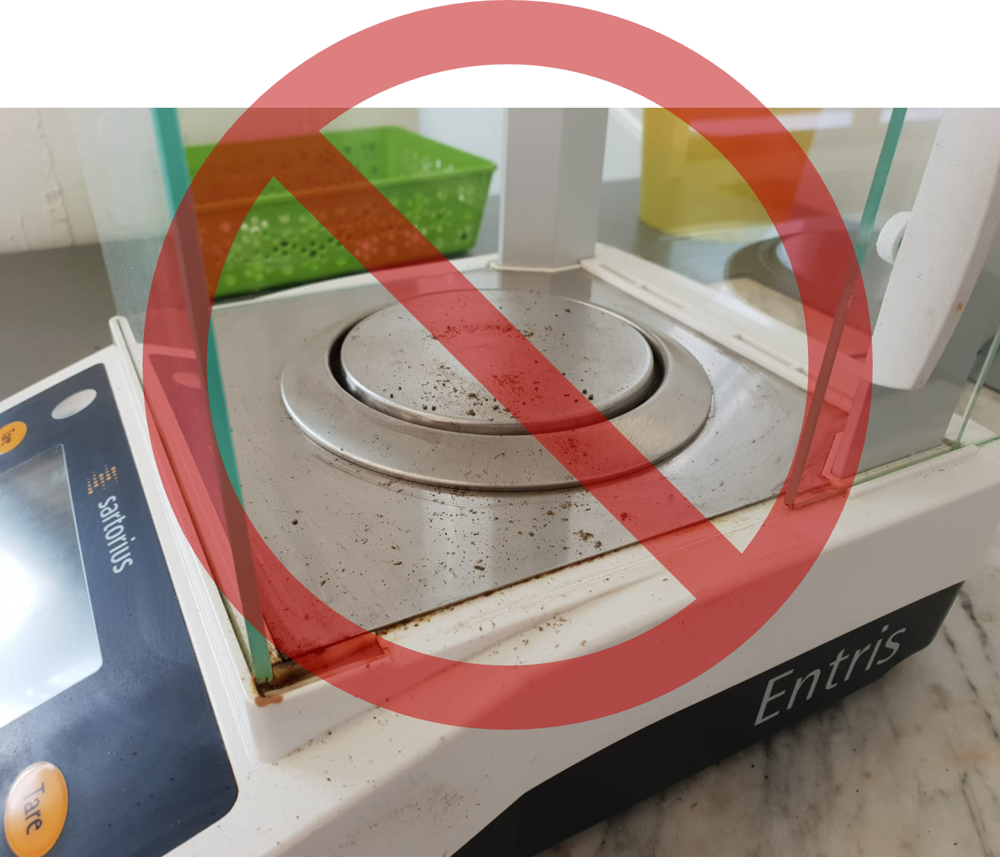
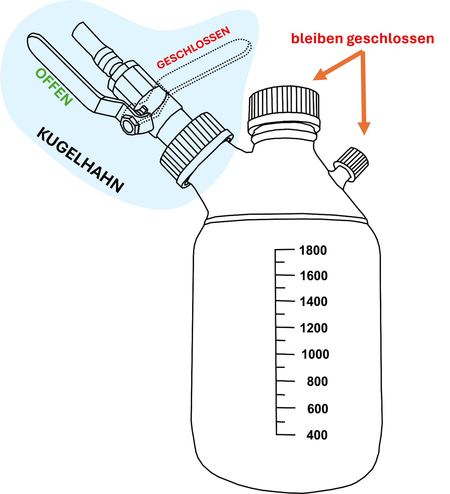
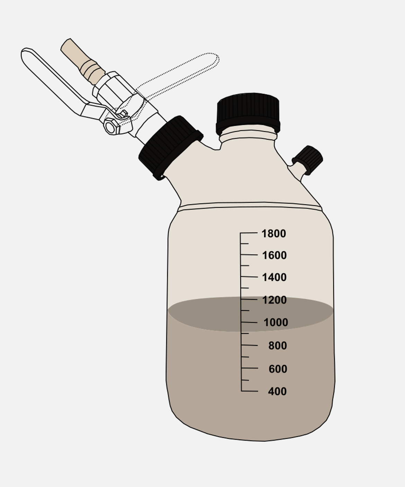
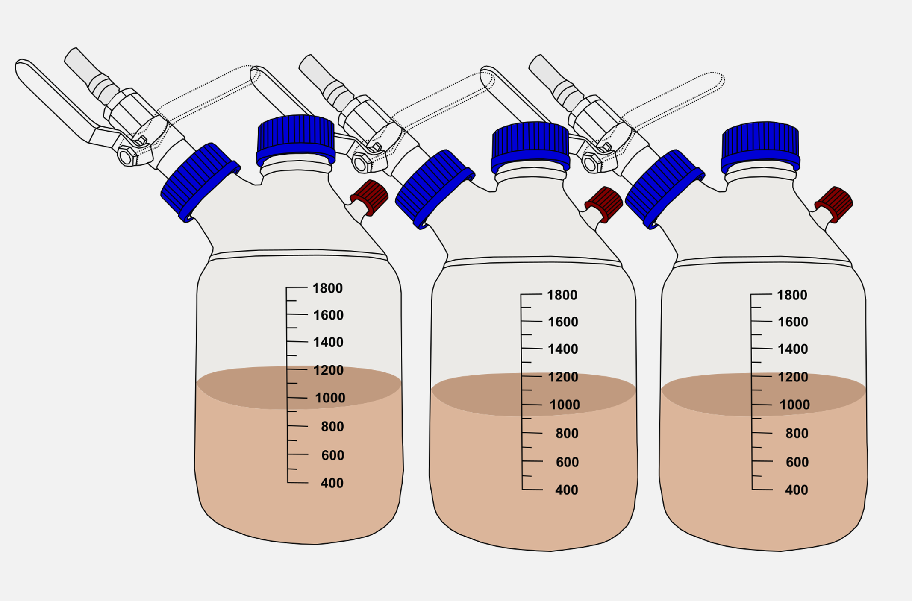
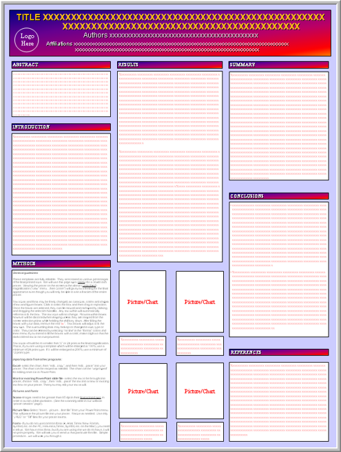
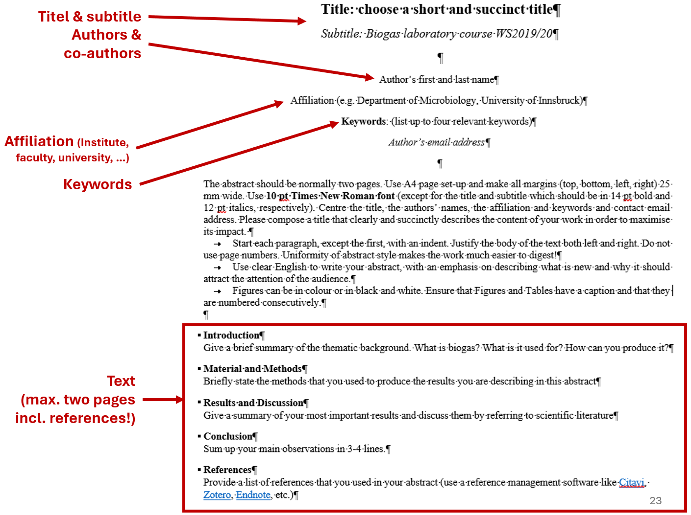
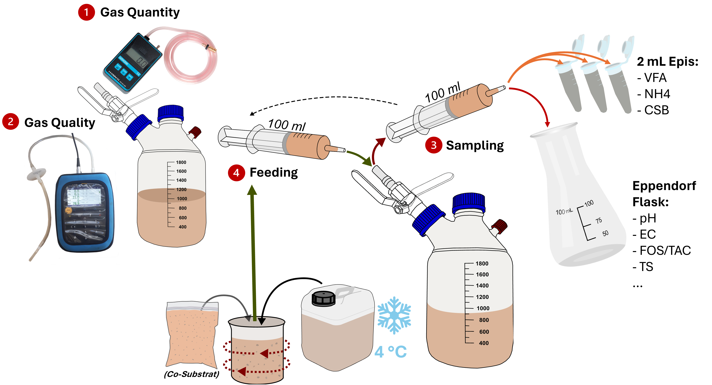

## Schedule

```{r}
library(reactable)

schedule <- read.csv(
  "../schedule.csv",
  sep = ";",
  check.names = FALSE,   # keep "08.11" as column name
  na.strings = "",       # empty cells become NA
  fileEncoding = "UTF-8" # keeps the "°C" intact
)

reactable(
  schedule,
  pagination = FALSE,
  sortable = FALSE,
  compact = TRUE,
  bordered = TRUE, 
  highlight = TRUE,
  defaultColDef = colDef(
    align = "center",
    na = "",             # show empty cells as blank instead of "–"
    headerStyle = list(
      background = "#ff9e53",
      color = "white",
      fontWeight = "bold"
    )
  ),
  columns = list(
    `08.11` = colDef(
    style = list(background = "#fff3cd", fontWeight = "bold"),
    headerStyle = list(background = "#e07a1f", color = "white")
    )),
  theme = reactableTheme(
    style = list(fontSize = "0.40em"),
    cellPadding = "2px 4px"
  )
)
```


## Grading

```{mermaid}
pie showData
  "Extended abstract" : 25
  "Introductory exam" : 25
  "Group work" : 25
  "Cooperation" : 25
```


## Grading

### Introductory exam
- 12 questions, primarily multiple-choice
- \>50% required to pass

### Cooperation
- Continously evaluated throughout the course:
  - Group work and independent work
  - On-time submission of results (e.g. extended abstract)


## Grading

### Fact sheet / Elevator pitch
- **Due**: until Friday, 15. November
- Fact sheet/Elevator pitch: Short summary of research question(s), aims and relevance

### Poster
- **Due**: until Wednesday, 11. December
- A3 format (PowerPoint, Inkscape, Canva, ...)
- Winning poster will be printed by us


## Grading

### Extended abstract

:::: {.columns}

::: {.column width=40%}

:::

::: {.column width=60%}
Step-by-step instructions:

::: {.small-list}
1. Download template from OLAT
2. Insert your text, check requirements
3. Save as .pdf and name "Abstract_Lastname.pdf"
4. Upload to OLAT repository
:::

:::

::::


## General rules

- Strictly no eating or drinking in the lab
- Clearly label ALL containers used
- Lab coats are mandatory
- When necessary: Use gloves and/or safety goggles
- In case of danger:  
**D-A-R-E** (**D**on’t panic, **A**larm, **R**escue, **E**xtinguish)


## General rules

Everyone should know where the following items/equipment are located:  

::: {.small-list}
  - [ ] First-aid kit  
  - [ ] Fire blanket  
  - [ ] Fire extinguisher  
  - [ ] Fire alarm button  
  - [ ] Emergency shower  
  - [ ] Eye wash station  
  - [ ] Main gas valve (?!)  
  - [ ] Evacuation assembly point
:::


## Safety




## Safety

:::: {.columns}

::: {.column width=60%}
- Leave work areas clean
- Attendance is mandatory
- Announce absences (exams, appointments, etc.) in advance
:::

::: {.column width=40%}

:::

::::


## Workflow

```{mermaid}
%%| fig-width: 8
%%| fig-height: 4.5
flowchart TD
  subgraph prep["Prepared ahead of the course"]
    A[Sieve manure]
    B[Store sieved manure]
    C[Fill into reactors]
  end
  subgraph course["Lab course"]
    subgraph Experiment start
      D(((Choose treatment)))
    end
    subgraph Biogas trial
      E[Take samples]
      F[Analyse samples]
      G[Terminate experiment]
      H[Clean reactors]
    end
  end
  A --> B
  B --> C
  D --> E
  E --> F
  F -.-> E
  F --> G
  G --> H
  prep --> |Start the trial| course
```


## Reactors

:::: {.colums}

::: {.column width=50%}

:::

::: {.column width=50%}
- Filling volume: 1000 mL sieved manure
  - *Ball valves are only opened for gas measurement, feeding, sampling*
- Feeding/Sampling
- **Regular** feeding volume
- **Regular** operation at 37 °C
:::

::::

::: {.credit}
Image: Thomas Klammsteiner
:::


## Treatments

### Options

**A.** Feeding volume: 50-300 mL  
**B.** Temperature: 10-60 °C  
**C.** Co-substrate: insect frass  
**D.** Co-substrate: waste oil (0.2-2 mg/L)  

<br>

### Per group:

::: {.small-list}
- Choose one treatment
- Operate one control reactor  
  *37 °C, 100 mL feeding volume without co-substrate, 0 rpm*
:::


## Topic selection

### Quiz

::: {.small-list-condensed}

- **Which genera can use acetate as substrate for methanogenesis?**

::: {.fragment style="color: #FF7F50;"}
Methanosarcina and Methanosaeta.
:::

<br>

::: {.fragment}
- **What is an eudiometer?**
:::

::: {.fragment style="color: #FF7F50;"}
A tube-like glass device to measure gas volume.
:::

<br>

::: {.fragment}
- **What does the abreviation VFA/TIC stand for?**
:::

::: {.fragment style="color: #FF7F50;"}
Volatile fatty acids to total inorganic carbon
:::

:::


## Topic selection

:::: {.columns}

::: {.column width=35%}

**1 control reactor**

::: {.small-list}
- Incubation at 37 °C
- No treatment
:::


:::

::: {.column width=65%}
**3 treatment reactors**

::: {.small-list}
- Incubation, feeding volume, co-substrate depend on chosen treatment
:::


:::

::::

::: {.credit}
Image: Thomas Klammsteiner
:::


## Control

:::: {.columns}

::: {.column width=25%}

Control reactor
**Group 1**


:::

::: {.column width=25%}

Control reactor
**Group 2**


:::

::: {.column width=25%}

Control reactor
**Group 3**


:::

::: {.column width=25%}

Control reactor
**Group 4**


:::

::::

::: {.credit}
Image: Thomas Klammsteiner
:::


## Deliverables

### Fact sheet / Elevator pitch
- Literature research about the chosen process parameter

  ::: {.small-list}
  - Practical relevance
  - Impact on methane production
  - Impact on microorganisms
  - Unresolved questions?
  - Potential for the future?
  :::

- Submission and presentation: Friday, 15. November 2024

  ::: {.small-list}
  - Elevator pitch: four minutes per group
  - Fact sheet: one A4 page per group
  :::


## Deliverables

:::: {.columns}

::: {.column width=50%}
### Fact sheet

::: {.small-list}
- Short summary of research questions and aims
- Brief overview on methods
- Most important results & impact
- Visualization of results
- Language adapted to target audience
:::


:::

::: {.column width=50%}
### Elevator pitch

::: {.small-list}
- Starts with research question and its relevance
- Highlight your unique approach
- Emphasize results and usefulness
- Clear language
- Ends with an invite for further discussion/support
:::


:::

::::


## Deliverables

:::: {.colums}

::: {.column width=50%}

### How to: Poster

::: {.small-list-condensed}
- Title
- Authors
- Affiliation
- <200 words per section:
  - Introduction
  - Methods
  - Results
  - Discussion/Summary
  - Conclusion
- Focus on visualization
- Cited references at the end
- Format: A3
:::

:::

::: {.column width=50%}



:::

::::


## Deliverables

### How to: Extended abstract




## Lab work

### How to: Sampling & Feeding



::: {.credit}
Image: Thomas Klammsteiner
:::