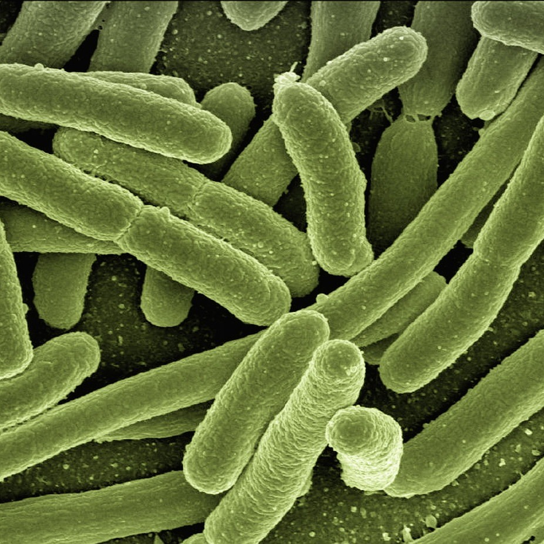
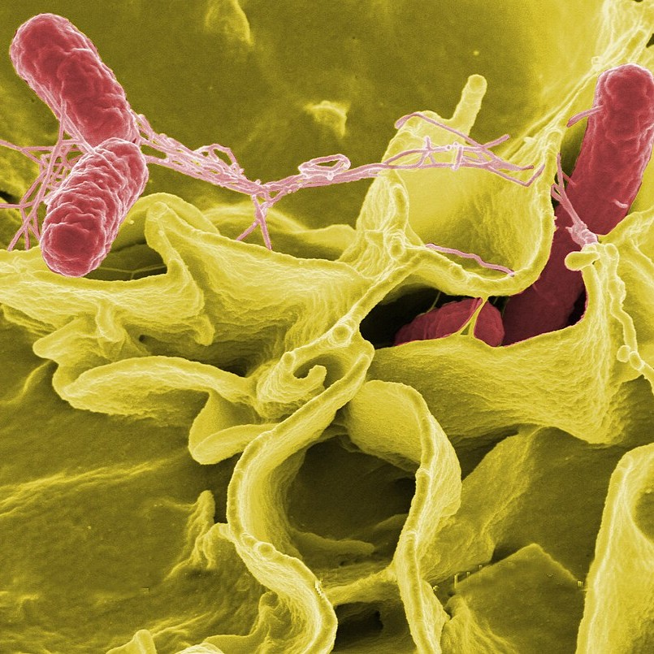
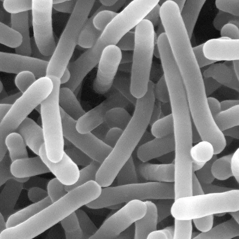
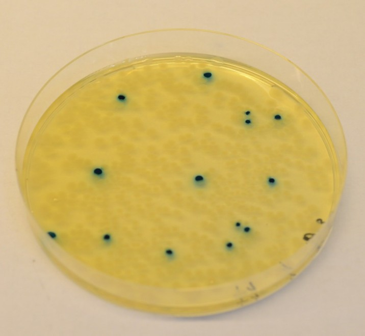
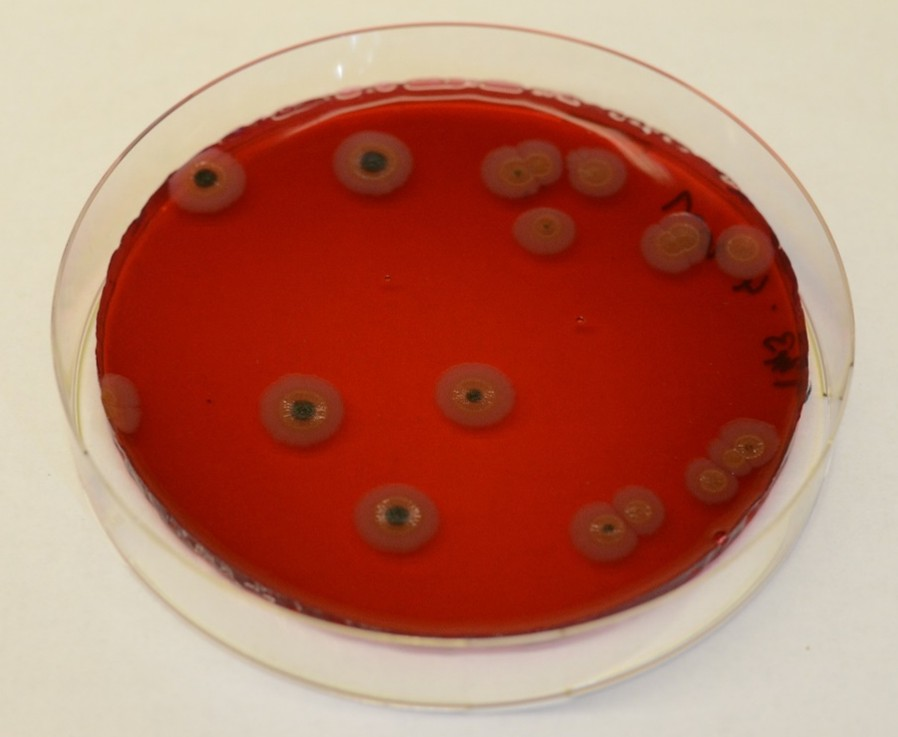
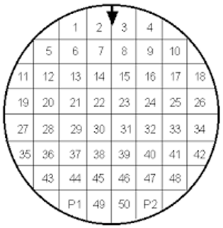
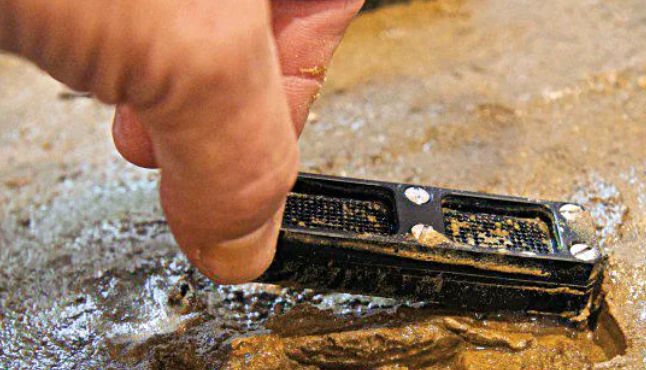
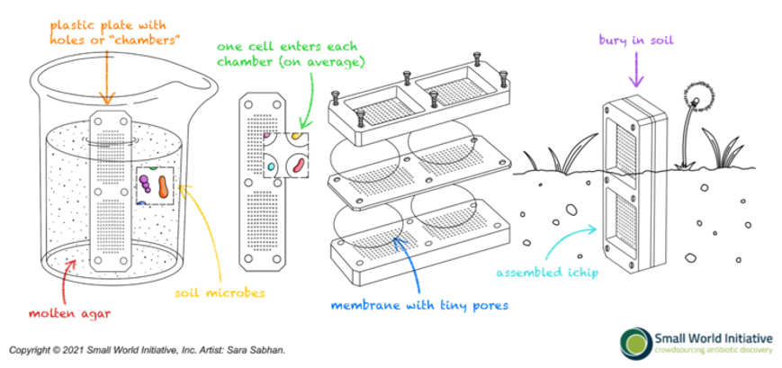

## Schedule

```{r}
library(reactable)

schedule <- read.csv(
  "../schedule.csv",
  sep = ";",
  check.names = FALSE,   # keep "08.11" as column name
  na.strings = "",       # empty cells become NA
  fileEncoding = "UTF-8" # keeps the "°C" intact
)

reactable(
  schedule,
  pagination = FALSE,
  sortable = FALSE,
  compact = TRUE,
  bordered = TRUE, 
  highlight = TRUE,
  defaultColDef = colDef(
    align = "center",
    na = "",             # show empty cells as blank instead of "–"
    headerStyle = list(
      background = "#ff9e53",
      color = "white",
      fontWeight = "bold"
    )
  ),
  columns = list(
    `11.11` = colDef(
    style = list(background = "#fff3cd", fontWeight = "bold"),
    headerStyle = list(background = "#e07a1f", color = "white")
    )),
  theme = reactableTheme(
    style = list(fontSize = "0.40em"),
    cellPadding = "2px 4px"
  )
)
```


## Pathogen test

:::: {.columns}

::: {.column width=33% .center}

**?**
:::

::: {.column width=33% .center}

**?**
:::

::: {.column width=33% .center}

**?**
:::

::::


## Pathogen test

:::: {.columns}

::: {.column width=33% .center}

_**E. coli**_
:::

::: {.column width=33% .center}

_**Salmonella sp.**_
:::

::: {.column width=33% .center}

_**Listeria sp.**_
:::

::::

::: {.credit}
Photo: Pixabay / geralt (*E. coli*), Rocky Mountain Laboratories, NIAID, NIH (*Salmonella sp.*), Penn State Extension (*Listeria sp.*)
:::


## Pathogen test

:::: {.columns}

::: {.column width=33% .center}

_**E. coli**_
:::

::: {.column width=33% .center}

_**Salmonella sp.**_
:::

::: {.column width=33% .center}
{style="filter: blur(6px);"}
_**Listeria sp.**_
:::

::::

::: {.credit}
Photo: Pixabay / geralt (*E. coli*), Rocky Mountain Laboratories, NIAID, NIH (*Salmonella sp.*), Penn State Extension (*Listeria sp.*)
:::


## Pathogen test

:::: {.columns}

::: {.column width=50%}

_**E. coli**_

::: {.small-list-condensed}
**Phylum**: Proteobacteria  
**Class**: Gammaproteobacteria  
**Family**: Enterobacteraceae  
:::

::: {.small-list-condensed}
- Gram-negative, no spores
- Rod-shaped, peritrichous
- Length: 2 µm, Ø: 0.25-1 µm
- Facultatively anaerobic
- Chemoorganotrophic
- Non-pathogenic and pathogenic groups (EHEC, ETEC, etc.)
:::

:::

::: {.column width=50%}

_**Salmonella sp.**_

::: {.small-list-condensed}
**Phylum**: Proteobacteria  
**Class**: Gammaproteobacteria  
**Family**: Enterobacteraceae  
:::

::: {.small-list-condensed}
- Gram-negative, no spores
- Rod-shaped, peritrichous
- Length: 2-5 µm, Ø: 0.7-1.5 µm
- Facultatively anaerobic
- Chemoorganotrophic
- Exclusively pathogenic
:::

:::

::::

## Pathogen test

### Chromocult agar

::: {.small-table}
| Test strains | CFU/mL | Colour | Recovery |
|-------------|--------|--------|----------|
| _E. coli_ ATCC 25922 | 10^3^-10^5^ | blue-green | ≥ 70% |
| _Citrobacter freundii_ ATCC 8090 | ≥ 10^5^ | - | ≤ 0.01%   |
| _Enterococcus faecalis_ ATCC 19433 | ≥ 10^5^ | - | ≤ 0.01% |
:::




## Pathogen test

### XLT-4 Agar

:::: {.columns}

::: {.column width=75%}

::: {.small-table}
| Test strains | Growth | Colour |
|--------------|--------|--------|
| _Salmonella typhimurium_ ATCC 14028 | good/very good | black center |
| _Salmonella enteritidis_ ATCC 13076 | good/very good | black center |
| _Salmonella anatum_ ATCC 9270 | good/very good | black center |
| _Shigella sonnei_ ATCC 11060 | good/very good | colourless |
| _Shigella flexneri_ ATCC 12022 | good/very good | colourless |
| _Enterobacter aerogenes_ ATCC 13048 | fair/good | yellow |
| _C. freundii_ ATCC 8090 | fair/good | yellow |
| _Proteus mirabilis_ ATCC 14273 | none/poor | - |
| _E. coli_ ATCC 25922 | none/fair | yellow-colourless |
:::

:::

::: {.column width=25%}



:::

::::


## Master plates

::: {.small-list-condensed}
- To isolate morphologically interesting and free-standing colonies from different media
- Colonies are transferred from the original culture medium to the STD agar master plate using sterile pipette tips
- Grid as a guide and for documentation purposes
- Please **do not pick** overlapping or fused colonies!
- Incubate the master plate at **37 °C**
:::




## iChip

::: {.small-list-condensed}
- **Problem**  
Only a fraction (approx. 1–2%) of microorganisms can be cultured

- **Reasons**  
Growth rate, dependencies, competition, nutrient requirements, communication, …

- **Improvements**  
Cultivation/isolation in the natural habitat:
  - Ideal environmental conditions (temperature, humidity, pH, etc.)
  - Sufficient nutrient availability
  - Inter- and intraspecific communication possible
:::



::: {.credit}
Photo: Slava Epstein
:::


## iChip



::: {.credit}
Photo: 2021 Small World Initiative, INC.
:::