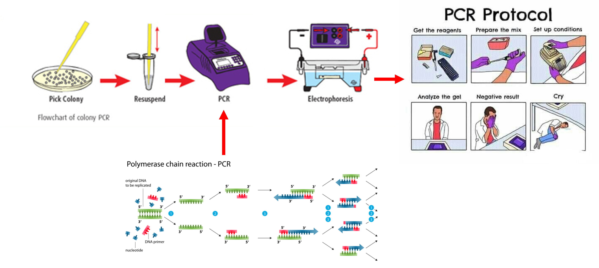
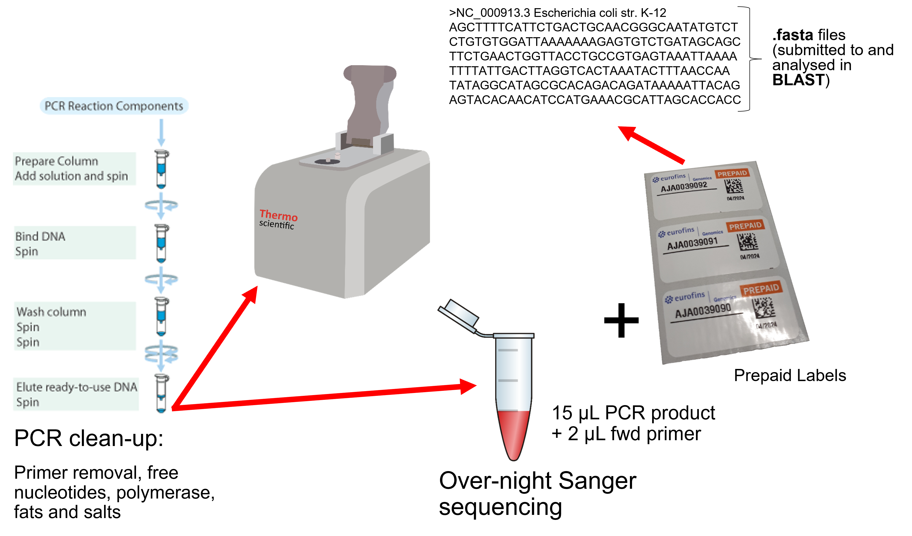
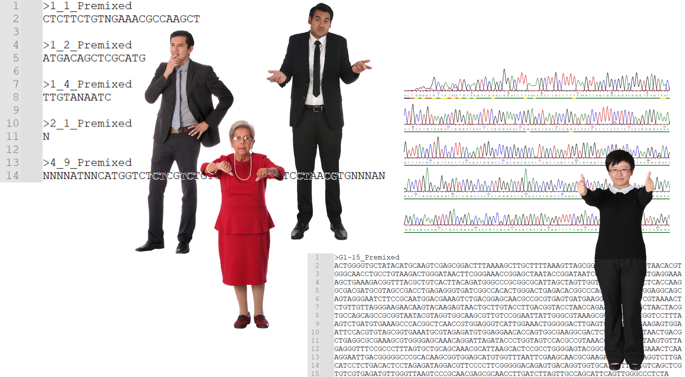
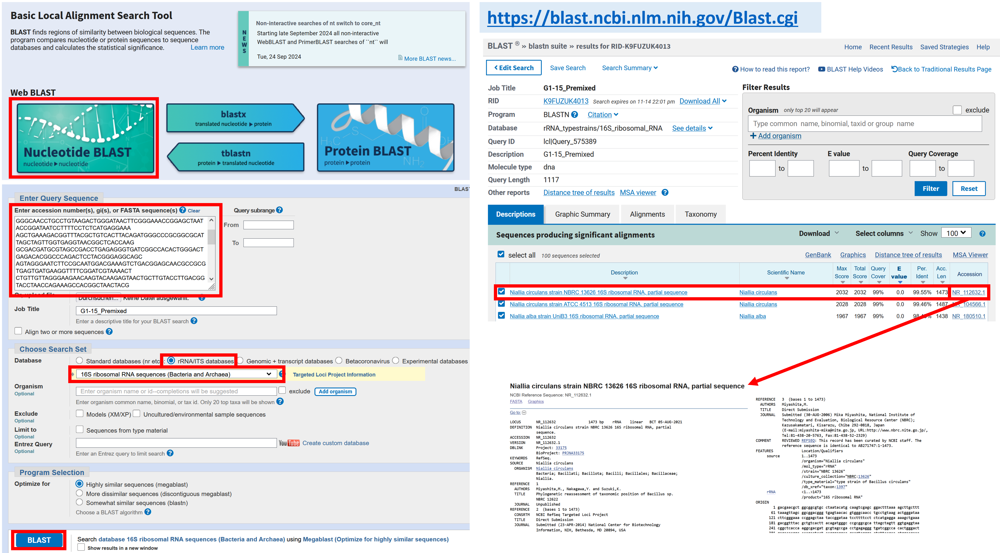

## Schedule

```{r}
library(reactable)

schedule <- read.csv(
  "../schedule.csv",
  sep = ";",
  check.names = FALSE,   # keep "08.11" as column name
  na.strings = "",       # empty cells become NA
  fileEncoding = "UTF-8" # keeps the "°C" intact
)

reactable(
  schedule,
  pagination = FALSE,
  sortable = FALSE,
  compact = TRUE,
  bordered = TRUE, 
  highlight = TRUE,
  defaultColDef = colDef(
    align = "center",
    na = "",             # show empty cells as blank instead of "–"
    headerStyle = list(
      background = "#ff9e53",
      color = "white",
      fontWeight = "bold"
    )
  ),
  columns = list(
    `14.11` = colDef(
    style = list(background = "#fff3cd", fontWeight = "bold"),
    headerStyle = list(background = "#e07a1f", color = "white")
    )),
  theme = reactableTheme(
    style = list(fontSize = "0.40em"),
    cellPadding = "2px 4px"
  )
)
```

## Colony PCR (recap)



::: {.credit}
Photo: www.edvotek.com, www.socmucimm.org
:::

## Sanger sequencing preparation



::: {.credit}
Image: Thomas Klammsteiner
:::


## Sanger sequencing results




## NCBI BLAST



