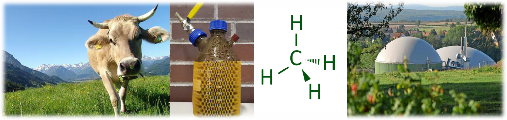

<br>



# About

In this lab, biogas—as an example of a renewable energy source—is produced in laboratory reactors. Students learn how to design structured experiments, conduct process monitoring, and evaluate, interpret, and correlate comprehensive data sets (physicochemical and microbiological parameters). During the lab, we will address the following questions:  

- How is biogas produced from waste/residual materials?
- Which process parameters influence biogas yield?
- How do I conduct proper monitoring?
- Which process parameters correlate with one another?

The lab course includes setup and operation of a reactor system in fed-batch mode, determination of biogas yield (gas volume and gas composition, or methane content), determination of relevant physicochemical process parameters (pH, TS/oTS, volatile fatty acids, ammonium, etc.), plating assay using selective agar plates to determine the hygienization potential as well as data analysis and interpretation.  

Find the current course details (dates and deadlines) at [uibk.ac.at](https://lfuonline.uibk.ac.at/public/lfuonline_lv.details?sem_id_in=23W&lvnr_id_in=718837&sprache_in=en) and [OLAT](https://lms.uibk.ac.at/url/RepositoryEntry/5478907904)


# Schedule

```{r, warning=FALSE, message=FALSE, echo=FALSE}
library(reactable)

schedule <- read.csv(
  "assets/slides/schedule.csv",
  sep = ";",
  check.names = FALSE,   # keep "08.11" as column name
  na.strings = "",       # empty cells become NA
  fileEncoding = "UTF-8" # keeps the "°C" intact
)

reactable(
  schedule,
  pagination = FALSE,
  sortable = FALSE,
  compact = TRUE,
  bordered = TRUE, 
  highlight = TRUE,
  defaultColDef = colDef(
    align = "center",
    na = "",             # show empty cells as blank instead of "–"
    headerStyle = list(
      background = "#ff9e53",
      color = "white",
      fontWeight = "bold"
    )
  ),
  theme = reactableTheme(
    style = list(fontSize = "0.75em"),
    cellPadding = "2px 4px"
  )
)
```

# Help section

## Abstract template

-   [Download abstract template](assets/abstract_lastname.docx)

**Instructions:** Stick to the provided format and don't change any site or font settings. Before submitting the final version of your abstract, please rename the document with "`abstract_<yourlastname>.docx`". Do not convert the document to `.pdf`.

Tipps and writing help:

-   Grech, V., 2018. WASP (Write a Scientific Paper): Preparing an abstract. Early Hum Dev 125, 51--52. <https://doi.org/10.1016/j.earlhumdev.2018.06.005>


## Poster guidelines

- Use A3 format with vertical orientation
- You can use PowerPoint, Inkscape, Adobe Illustrator or whatever illustration software you like
- **Don't print the poster!**  We are going to vote on the best poster, and the winning one will be printed for you.

Tips and design help:

- Gundogan, B., Koshy, K., Kurar, L., Whitehurst, K., 2016. How to make an academic poster. Ann Med Surg 11, 69--71. <https://doi.org/10.1016/j.amsu.2016.09.001>
- Pamplona, F., 2022. Award-winning scientific posters: steps to success. [https://mindthegraph.com/blog/award-winning-scientific-poster/](https://mindthegraph.com/blog/award-winning-scientific-poster/)


## Tips for your presentation

#### ...for this course

- **Clear Structure**: Organize your presentation with a clear structure, including an introduction, objectives, methods, results, and conclusions. Ensure a logical flow from one section to the next.

- **Engaging Introduction**: Start with a compelling introduction to grab your audience's attention. Clearly state the research question or problem your study addresses.

- **Visual Aids**: Utilize visuals such as slides, graphs, charts, and images to enhance understanding. Keep visuals simple, with key points highlighted, and ensure they are visible to the entire audience.

- **Concise Content**: Be concise in your content. Avoid information overload and focus on key findings and their significance. Stay within the allotted time for your presentation.

- **Question Anticipation**: Anticipate potential questions and be prepared to address them. This demonstrates a deep understanding of your research and enhances your credibility.

- **Time Management**: Respect the allocated time for your presentation. Practice pacing to ensure you cover all essential points without rushing.

- **Closing Remarks**: Conclude with a summary of key points and their broader implications.

- **Confidence**: Project confidence in your delivery. Believe in the importance of your research, and let that enthusiasm shine through your presentation.  


#### ...in general

- **Effective Communication**: Speak clearly and at a moderate pace. Maintain eye contact with the audience, and be mindful of your body language. Practice your presentation to refine your delivery.

- **Know Your Audience**: Tailor your presentation to your audience's level of expertise. Avoid unnecessary jargon and explain technical terms when needed.

- **Practice**: Rehearse your presentation multiple times to familiarize yourself with the content and flow. Practice in front of a mirror, colleagues, or friends for constructive feedback.

- **Engage Your Audience**: Encourage audience participation through questions or interactive elements. This keeps your audience engaged and shows your enthusiasm for the topic.

<br>


***

# Throwback

### Course info from previous years:
- Winter term 2023/2024 [[Link]](https://lfuonline.uibk.ac.at/public/lfuonline_lv.details?sem_id_in=23W&lvnr_id_in=718837&sprache_in=en) | [[OLAT Link]](https://lms.uibk.ac.at/url/RepositoryEntry/5478907904)
  - Student assistant: Sophia Strobl
  - Number of students: 14  
  
- Winter term 2022/2023 [[Link]](https://lfuonline.uibk.ac.at/public/lfuonline_lv.details?sem_id_in=22W&lvnr_id_in=718837&sprache_in=en) | [[OLAT Link]](https://lms.uibk.ac.at/url/RepositoryEntry/5350293593)
  - Student assistant: Maria Payr
  - Number of students: 15

- Winter term 2021/2022 [[Link]](https://lfuonline.uibk.ac.at/public/lfuonline_lv.details?sem_id_in=21W&lvnr_id_in=718837&sprache_in=en) | [[OLAT Link]](https://lms.uibk.ac.at/url/RepositoryEntry/5125996704)
  - Student assistant: Katharina Nussbaumer
  - Number of students: 12

- Winter term 2020/2021 [[Link]](https://lfuonline.uibk.ac.at/public/lfuonline_lv.details?sem_id_in=20W&lvnr_id_in=718837&sprache_in=en) | [[OLAT Link]](https://lms.uibk.ac.at/url/RepositoryEntry/4877517195)
  - Student assistant: Sophia Strobl
  - Number of students: 11

- Winter term 2019/2020 [[Link]](https://lfuonline.uibk.ac.at/public/lfuonline_lv.details?sem_id_in=19W&lvnr_id_in=718837&sprache_in=en) | [[OLAT Link]](https://lms.uibk.ac.at/url/RepositoryEntry/4563534076)
  - Student assistant: Julia Zöhrer
  - Number of students: 13

- Winter term 2018/2019 [[Link]](https://lfuonline.uibk.ac.at/public/lfuonline_lv.details?sem_id_in=18W&lvnr_id_in=718837&sprache_in=en) | [[OLAT Link]](https://lms.uibk.ac.at/url/RepositoryEntry/4390126846)
  - Student assistant: Anna Winkler
  - Number of students: 13